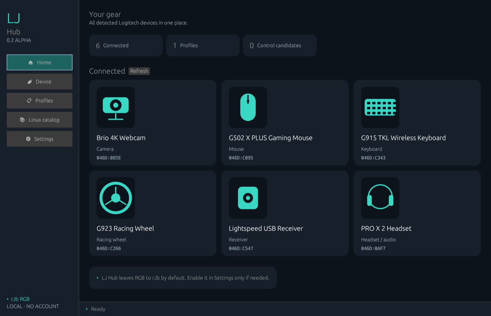
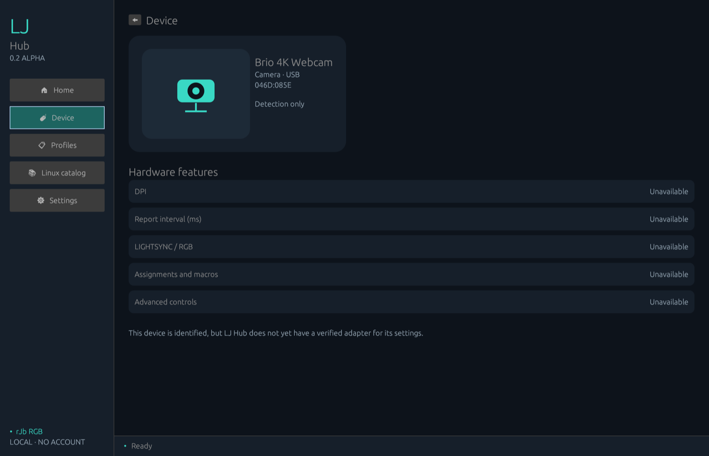
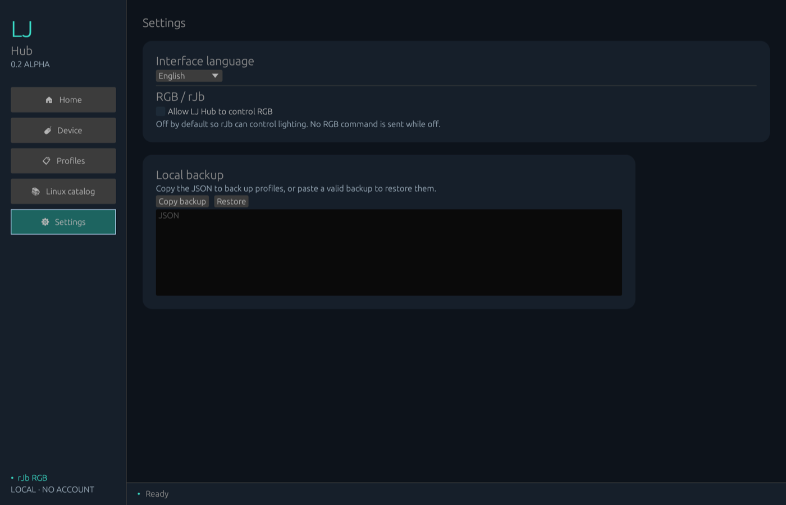

<p align="center"></p>

# LJ Hub

[](https://github.com/jeremdevgit/lj-hub/actions/workflows/ci.yml) [](https://github.com/jeremdevgit/lj-hub/security/code-scanning)

[English](README.md) · [Français](README.fr.md) · [**Español**](README.es.md)

Gestor ligero y local de perfiles para dispositivos Logitech en Windows, macOS y Linux. **Versión alfa: aún no reemplaza G HUB.** Proyecto independiente, sin afiliación con Logitech.

## Descargar

Descarga la [versión alfa 0.2.0](https://github.com/jeremdevgit/lj-hub/releases/tag/v0.2.0-alpha.1). Windows incluye un instalador `.exe` por usuario, macOS un `.dmg` Apple Silicon y Linux un paquete `.deb` x64 para Ubuntu/Debian. Los instaladores crean un acceso directo y se pueden desinstalar. Los paquetes de Windows y macOS no están firmados por un editor reconocido ni notarizados.

La nueva interfaz muestra los dispositivos conectados en tarjetas, con una vista por categoría y el estado de sus funciones. Permite crear y duplicar perfiles y copiar o restaurar una copia JSON local validada. Está disponible en ocho idiomas: francés, inglés, español, alemán, italiano, portugués, chino simplificado y japonés. También permite consultar 116 identificadores del catálogo de `libratbag`; la lista no es exhaustiva para G HUB ni garantiza compatibilidad. En Windows, intenta configurar el DPI y el intervalo de informe en ratones con cable que anuncian las funciones HID++ 2.0 correspondientes y comprueba el resultado mediante lectura; esta función sigue siendo experimental y aún no se ha validado con modelos físicos. En Linux, estos ajustes pasan por `ratbagd` para ratones compatibles.

El inventario del sistema también muestra dispositivos Logitech USB/PnP no HID, como cámaras y volantes, aunque aún no permite configurarlos. El control RGB de LJ Hub está **desactivado por defecto** para dejar la iluminación a rJb. En Linux puede activarse manualmente para enviar un color fijo al LED 0 de dispositivos compatibles con `ratbagd`. Macros, asignación de botones, otros efectos de iluminación, audio, cámaras, volantes, firmware y cambio automático de perfil siguen pendientes. Detectar un dispositivo no garantiza que pueda configurarse.


## Capturas

Datos de demostración, capturados de la interfaz real.



<p> </p>

## Compilación

Instala Rust estable y las dependencias de desarrollo indicadas en [README.md](README.md). Ejecuta:

```sh
cargo run --locked --release
```

Los perfiles se guardan localmente. No se necesita una cuenta ni acceso a Internet. Mantenido por [jeremdevgit](https://github.com/jeremdevgit), bajo GPL-3.0-or-later.

## Mis otros programas

Todos libres, gratuitos y sin publicidad — [github.com/jeremdevgit](https://github.com/jeremdevgit):

| Programa | Plataforma | En resumen |
|---|---|---|
| [AutoDex](https://github.com/jeremdevgit/autodex) | Windows, macOS, Linux | Juego de colección de coches con reconocimiento de fotos en el dispositivo |
| [Boîte à outils](https://github.com/jeremdevgit/boite-a-outils) | Windows, macOS | Mantenimiento del ordenador, limpieza y búsqueda de archivos |
| [Carnet de notes](https://github.com/jeremdevgit/carnet-rust) | Windows | Cuadernos cifrados y sincronización experimental |
| [Decklight](https://github.com/jeremdevgit/decklight) | Windows, macOS, Linux | Stream Deck virtual con control USB |
| [JMeca](https://github.com/jeremdevgit/jmeca) | Windows, macOS, Linux | Seguimiento de mantenimiento de vehículos cifrado |
| [Pomme](https://github.com/jeremdevgit/pomme) | Windows | Reproductor de música para Apple Music y archivos locales |
| [rJb](https://github.com/jeremdevgit/rjb) | Windows | Control de la iluminación RGB |
| [Ludothèque](https://github.com/jeremdevgit/ludotheque) | macOS | Biblioteca y lanzador de juegos |
| [Suite Libre](https://jeremdevgit.github.io/suite-libre/) | Navegador | Seis herramientas sin cuenta |
| [Batailles de France](https://github.com/jeremdevgit/batailles-de-france) | Navegador | Juego de estrategia en tiempo real |
