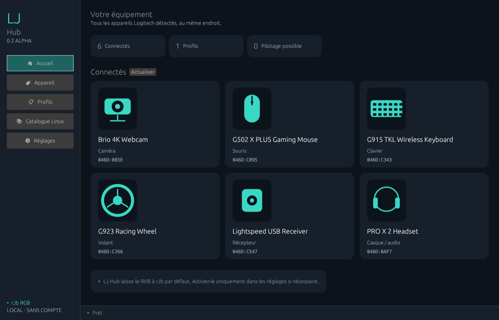
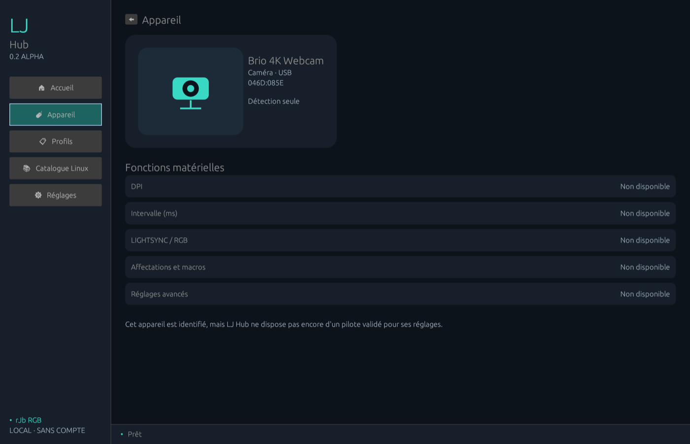
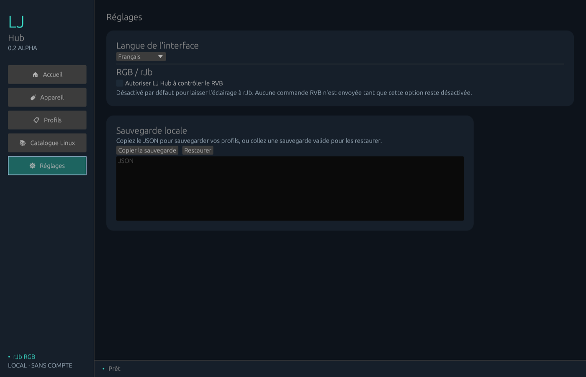

<p align="center"></p>

<h1 align="center">LJ Hub</h1>

<p align="center"><b>Profils et inventaire locaux pour les périphériques Logitech, avec réglage expérimental du DPI et de la fréquence.</b></p>

<p align="center"> <a href="https://github.com/jeremdevgit/lj-hub/releases"></a> <a href="LICENSE"></a> <a href="https://github.com/jeremdevgit/lj-hub/actions/workflows/ci.yml"></a></p>

<p align="center"><a href="README.md">English</a> · <b>Français</b> · <a href="README.es.md">Español</a> · <a href="README.de.md">Deutsch</a> · <a href="README.it.md">Italiano</a> · <a href="README.pt.md">Português</a> · <a href="README.zh.md">简体中文</a> · <a href="README.ja.md">日本語</a></p>

<p align="center"><a href="https://github.com/jeremdevgit/lj-hub/releases"><b>⬇ Télécharger</b></a></p>



LJ Hub est un gestionnaire léger et local pour les périphériques de jeu Logitech. **C'est une alpha, pas encore un remplaçant de G HUB**, et un projet indépendant, non affilié à Logitech.

<p> </p>

## En bref

| | |
|---|---|
| **Catégorie** | 🛠️ Système et matériel |
| **Plateformes** | Windows · macOS · Linux |
| **Interface** | 8 langues (EN, FR, ES, DE, IT, PT, ZH, JA) |
| **Prix** | Gratuit, open source, sans publicité ni télémétrie |
| **État** | Alpha |
| **Licence** | [GPL-3.0-or-later](LICENSE) |

## Ce qui fonctionne aujourd'hui

| Fonction | Windows | macOS | Linux |
|---|:-:|:-:|:-:|
| Détecter les appareils USB HID Logitech | ✅ | ✅ | ✅ |
| Créer, modifier, dupliquer et sauvegarder des profils locaux (JSON) | ✅ | ✅ | ✅ |
| Tableau de bord avec aperçus par catégorie et état des capacités | ✅ | ✅ | ✅ |
| Rechercher 116 identifiants Logitech (catalogue libratbag figé) | ✅ | ✅ | ✅ |
| Inventaire USB/PnP du système (caméras, volants…) | ✅ | ✅ | ✅ |
| Régler le DPI et la fréquence de rapport | 🧪 souris filaires HID++ 2.0 | — | 🧪 via `ratbagd` |
| Couleur fixe sur la LED 0 | — | — | 🧪 sur demande, via `ratbagd` |

🧪 = expérimental, pas encore vérifié sur des modèles physiques.

Le RVB est **désactivé par défaut** pour laisser l'éclairage à [rJb](https://github.com/jeremdevgit/rjb). Macros, réaffectation des touches, effets LIGHTSYNC, audio, webcams, volants, firmware, détection des jeux et changement automatique de profil ne sont pas implémentés. Voir un appareil dans l'inventaire ne veut pas dire qu'il est configurable.

## Installer

Téléchargez la dernière préversion sur la [page des versions](https://github.com/jeremdevgit/lj-hub/releases) : installateur `.exe` par utilisateur pour Windows, `.dmg` Apple Silicon pour macOS et `.deb` pour Ubuntu/Debian x64. Les paquets Windows et macOS ne sont pas signés par un éditeur de confiance. Sous Linux, les réglages matériels demandent `ratbagd`, `ratbagctl` et un appareil pris en charge par libratbag.

## Sécurité et confidentialité

- **Aucune requête réseau, aucun compte.** Les profils restent dans le dossier de configuration utilisateur du système.
- Les écritures matérielles sont facultatives, vérifiées par rapport aux valeurs annoncées puis relues ; elles ne seront activées appareil par appareil qu'après des tests.

## Feuille de route

1. Vérifier les capacités HID++ sur de vrais appareils, pour chaque système.
2. Une table de capacités testée pour le DPI, la fréquence, le RVB et les profils embarqués.
3. Réaffectation des boutons et moteur de macros encadré.
4. Casques, micros, webcams et volants là où les protocoles sont documentés.
5. Changement de profil par jeu.

## Compiler

```sh
# Rust stable. Sous Linux aussi : libudev-dev libx11-dev libxi-dev libxcursor-dev
# libxrandr-dev libxkbcommon-dev libwayland-dev pkg-config
cargo run --locked --release
```

Le catalogue vient des [fichiers d'appareils de libratbag](https://github.com/libratbag/libratbag/tree/master/data/devices) au commit noté dans `data/libratbag-logitech.json` ; actualisation : `python3 tools/refresh_libratbag_catalog.py /chemin/vers/libratbag`. Changements : [CHANGELOG.md](CHANGELOG.md).

## Licence

GPL-3.0-or-later — voir [LICENSE](LICENSE). Logitech, G HUB et LIGHTSYNC sont des marques de leur propriétaire.

---

Une faille de sécurité ? Signalez-la en privé (voir [SECURITY.md](SECURITY.md)) plutôt que dans un ticket public.

## Mes autres logiciels libres

Tous gratuits, open source et sans publicité.

**🛠️ Système et matériel** — [Boîte à outils](https://github.com/jeremdevgit/boite-a-outils) · [rJb](https://github.com/jeremdevgit/rjb) · [Decklight](https://github.com/jeremdevgit/decklight)

**📒 Productivité et données** — [Carnet de notes](https://github.com/jeremdevgit/carnet-rust) · [JMeca](https://github.com/jeremdevgit/jmeca) · [Suite Libre](https://jeremdevgit.github.io/suite-libre/)

**🎮 Musique et jeux** — [Pomme](https://github.com/jeremdevgit/pomme) · [Ludothèque](https://github.com/jeremdevgit/ludotheque) · [AutoDex](https://github.com/jeremdevgit/autodex) · [Batailles de France](https://github.com/jeremdevgit/batailles-de-france)
