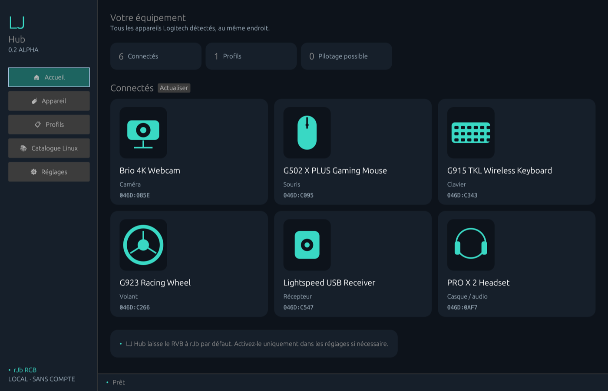
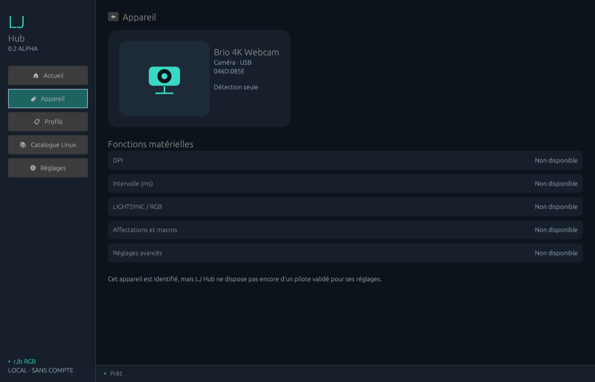
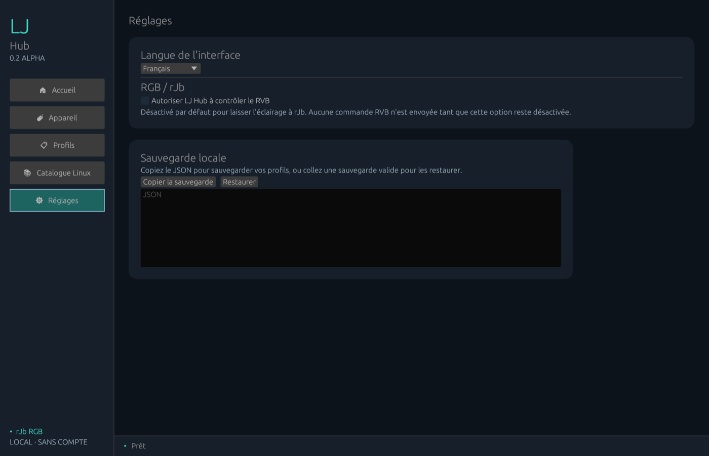

# LJ Hub

[](https://github.com/jeremdevgit/lj-hub/actions/workflows/ci.yml) [](https://github.com/jeremdevgit/lj-hub/security/code-scanning)

[English](README.md) · [**Français**](README.fr.md) · [Español](README.es.md)

Gestionnaire léger et local de profils pour périphériques Logitech, sur Windows, macOS et Linux. **Préversion initiale : LJ Hub ne remplace pas encore G HUB.** Projet indépendant, sans affiliation avec Logitech.

## Télécharger

Téléchargez la [préversion 0.2.0](https://github.com/jeremdevgit/lj-hub/releases/tag/v0.2.0-alpha.1). Windows dispose d'un installateur `.exe` par utilisateur, macOS d'un `.dmg` Apple Silicon et Linux d'un paquet `.deb` x64 pour Ubuntu/Debian. Les installateurs créent un raccourci et se désinstallent normalement. Les paquets Windows et macOS ne sont pas signés par un éditeur reconnu ni notarisés.

La nouvelle interface présente les appareils connectés en cartes, avec un aperçu par catégorie et l'état des fonctions. Elle permet de créer, dupliquer et sauvegarder les profils, puis de copier ou restaurer une sauvegarde JSON locale validée. Elle est disponible en huit langues : français, anglais, espagnol, allemand, italien, portugais, chinois simplifié et japonais. Elle permet aussi de consulter 116 identifiants issus du catalogue `libratbag` ; cette liste n'est ni exhaustive pour G HUB ni une garantie de compatibilité. Sous Windows, elle tente de régler le DPI et l'intervalle de rapport sur les souris filaires qui annoncent ces fonctions HID++ 2.0 ; chaque écriture est relue, mais cette prise en charge reste expérimentale faute de test sur des modèles physiques. Sous Linux, ces réglages passent par `ratbagd` sur les souris prises en charge.

L'inventaire système affiche aussi les périphériques USB/PnP Logitech non HID, notamment les caméras et volants. Il ne les configure pas encore. Le contrôle RVB de LJ Hub est **désactivé par défaut** pour laisser l'éclairage à rJb ; sous Linux, il peut être activé manuellement pour envoyer une couleur fixe à la LED 0 des modèles compatibles avec `ratbagd`. Macros, affectation des boutons, autres effets lumineux, audio, webcams, volants, micrologiciels et changement automatique de profil restent à développer. La détection ne garantit pas la compatibilité de configuration.


## Captures

Données de démonstration, capturées depuis la vraie interface.



<p> </p>

## Compilation

Installe Rust stable. Sous Linux, installe les paquets de développement `libudev`, X11, Wayland et `pkg-config` (détail dans [README.md](README.md)). Puis :

```sh
cargo run --locked --release
```

Les profils restent dans le dossier de configuration de l'utilisateur. Aucun compte ni accès réseau n'est nécessaire. Projet maintenu par [jeremdevgit](https://github.com/jeremdevgit), sous licence GPL-3.0-or-later.

## Mes logiciels

Tous libres et gratuits — [github.com/jeremdevgit](https://github.com/jeremdevgit) :

| Logiciel | Plateforme | En bref |
|---|---|---|
| [Boîte à outils](https://github.com/jeremdevgit/boite-a-outils) | Windows, macOS | Entretien de l’ordinateur et recherche de fichiers |
| [Carnet de notes](https://github.com/jeremdevgit/carnet-rust) | Windows | Notes chiffrées et synchronisation expérimentale |
| [JMeca](https://github.com/jeremdevgit/jmeca) | Windows, macOS, Linux | Suivi d’entretien automobile chiffré |
| [Decklight](https://github.com/jeremdevgit/decklight) | Windows, macOS, Linux | Stream Deck virtuel avec contrôle USB |
| [AutoDex](https://github.com/jeremdevgit/autodex) | Windows, macOS, Linux, web | Collection de voitures avec reconnaissance photo |
| [Pomme](https://github.com/jeremdevgit/pomme) | Windows | Apple Music et musique locale |
| [rJb](https://github.com/jeremdevgit/rjb) | Windows | Éclairage RGB |
| [Ludothèque](https://github.com/jeremdevgit/ludotheque) | macOS | Bibliothèque et lanceur de jeux |
| [Suite Libre](https://github.com/jeremdevgit/suite-libre) | Navigateur | Six outils sans compte |
| [Batailles de France](https://github.com/jeremdevgit/batailles-de-france) | Navigateur | Jeu de stratégie en temps réel |
