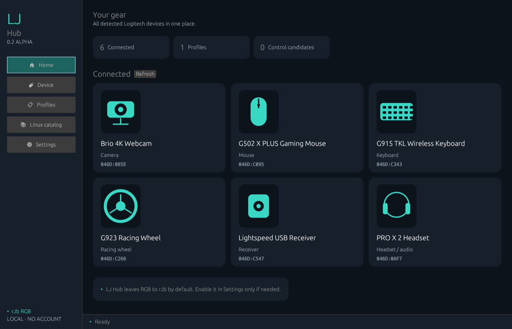
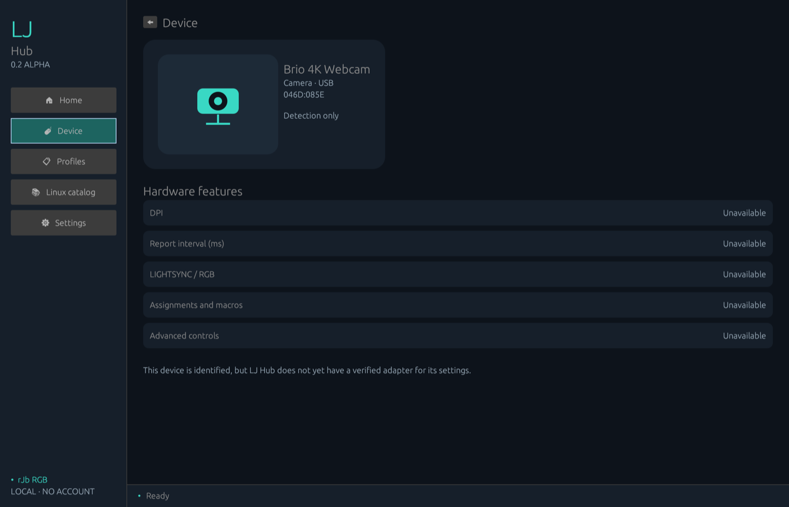
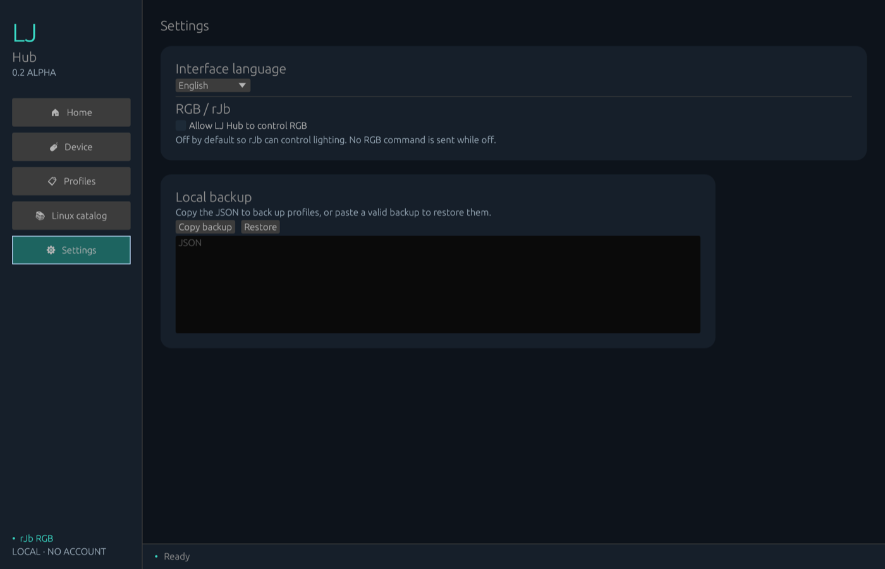

<p align="center"></p>

# LJ Hub

[](https://github.com/jeremdevgit/lj-hub/actions/workflows/ci.yml) [](https://github.com/jeremdevgit/lj-hub/security/code-scanning)

[**English**](README.md) · [Français](README.fr.md) · [Español](README.es.md)

Lightweight, local-first Logitech gaming device profile manager for Windows, macOS and Linux. **Early alpha:** this is not yet a G HUB replacement. It is an independent open-source project and is not affiliated with Logitech.

## Download

Download the [0.2.0 alpha release](https://github.com/jeremdevgit/lj-hub/releases/tag/v0.2.0-alpha.1). Windows has a per-user `.exe` installer, macOS has an Apple Silicon `.dmg`, and Linux has an Ubuntu/Debian x64 `.deb`. The installers add an application shortcut and support normal uninstallation. The Windows and macOS packages are not notarized or signed with a trusted publisher certificate.


## Screenshots

Demonstration data, captured from the real interface.



<p> </p>

## What works today

| Feature | Windows | macOS | Linux |
|---|---|---|---|
| Discover Logitech USB HID devices | Yes | Yes | Yes |
| Create, edit and save local profiles | Yes | Yes | Yes |
| Connected-device dashboard with category previews and capability status | Yes | Yes | Yes |
| Duplicate profiles and copy/restore a validated local JSON backup | Yes | Yes | Yes |
| Interface in 8 languages | Yes | Yes | Yes |
| Search 116 Logitech IDs from a pinned libratbag catalog | Yes | Yes | Yes |
| System USB/PnP inventory beyond HID (for example cameras and wheels) | Yes | Yes | Yes |
| Set DPI and report interval | HID++ 2.0 corded mice that advertise these features (experimental) | — | Supported `ratbagd` mice |
| Set LED 0 static color with `ratbagd` | — | — | Supported devices, opt-in only |

RGB control is **off by default** so rJb can own the lighting. While off, LJ Hub sends no RGB commands. On Linux, users can explicitly opt in to send the profile's static color to LED 0 through `ratbagd` on devices that expose it. On Windows, DPI and report interval controls query the HID++ feature table, check advertised values, then read back the result. They are experimental and have not yet been verified on physical models; wireless receiver children and model-specific protocols are not covered. Notes stay local. Device-specific controls, macros, key mapping, LIGHTSYNC effects, audio, webcam, wheels, firmware, game detection, cloud profiles and automatic profile switching are not implemented. System inventory and USB discovery do not imply a device can be configured. Linux hardware controls require `ratbagd`, `ratbagctl` and a device supported by libratbag.

The bundled ID catalog is generated from [libratbag's device files](https://github.com/libratbag/libratbag/tree/master/data/devices) at the pinned commit recorded in `data/libratbag-logitech.json`. It is a Linux driver reference, **not** an exhaustive list of G HUB devices or a claim of hardware control. Connected Logitech USB devices are still shown even if absent from that catalog. Maintainers can refresh it with `python3 tools/refresh_libratbag_catalog.py /path/to/libratbag`.

## Build

Install the stable Rust toolchain. On Linux, install `libudev-dev`, `libx11-dev`, `libxi-dev`, `libxcursor-dev`, `libxrandr-dev`, `libxkbcommon-dev`, `libwayland-dev` and `pkg-config` or their distribution equivalents. Then run:

```sh
cargo run --locked --release
```

The application stores profiles in the operating system's user configuration directory. It makes no network requests and requires no account. No personal data or service credentials are included in the repository.

## Roadmap toward G HUB parity

1. Verify device-specific HID++ capabilities with physical Logitech devices on each system.
2. Add a safe capability table and tests for DPI, polling rate, RGB and onboard profiles.
3. Implement button mapping and a bounded macro engine with explicit user control.
4. Add headset, microphone, webcam and racing device adapters where documented protocols exist.
5. Add per-game profile switching and automatic application of validated device profiles.

Hardware write support will be enabled per device only after testing. Claims of full G HUB parity would be premature because many functions depend on undocumented model-specific protocols.

## Project

Maintainer: [jeremdevgit](https://github.com/jeremdevgit). Licensed under GPL-3.0-or-later. See [SECURITY.md](SECURITY.md) and [CHANGELOG.md](CHANGELOG.md). Interface: français, English, español, Deutsch, italiano, português, 简体中文, 日本語.

## My other software

All free, open source and ad-free — [github.com/jeremdevgit](https://github.com/jeremdevgit):

| Software | Platform | In short |
|---|---|---|
| [AutoDex](https://github.com/jeremdevgit/autodex) | Windows, macOS, Linux | Car collection game with on-device photo recognition |
| [Boîte à outils](https://github.com/jeremdevgit/boite-a-outils) | Windows, macOS | Computer maintenance, cleanup and file search |
| [Carnet de notes](https://github.com/jeremdevgit/carnet-rust) | Windows | Encrypted notebooks and experimental sync |
| [Decklight](https://github.com/jeremdevgit/decklight) | Windows, macOS, Linux | Virtual Stream Deck with USB control |
| [JMeca](https://github.com/jeremdevgit/jmeca) | Windows, macOS, Linux | Encrypted vehicle maintenance tracker |
| [Pomme](https://github.com/jeremdevgit/pomme) | Windows | Apple Music and local music player |
| [rJb](https://github.com/jeremdevgit/rjb) | Windows | RGB lighting control |
| [Ludothèque](https://github.com/jeremdevgit/ludotheque) | macOS | Game library and launcher |
| [Suite Libre](https://jeremdevgit.github.io/suite-libre/) | Browser | Six tools without an account |
| [Batailles de France](https://github.com/jeremdevgit/batailles-de-france) | Browser | Real-time strategy game |
