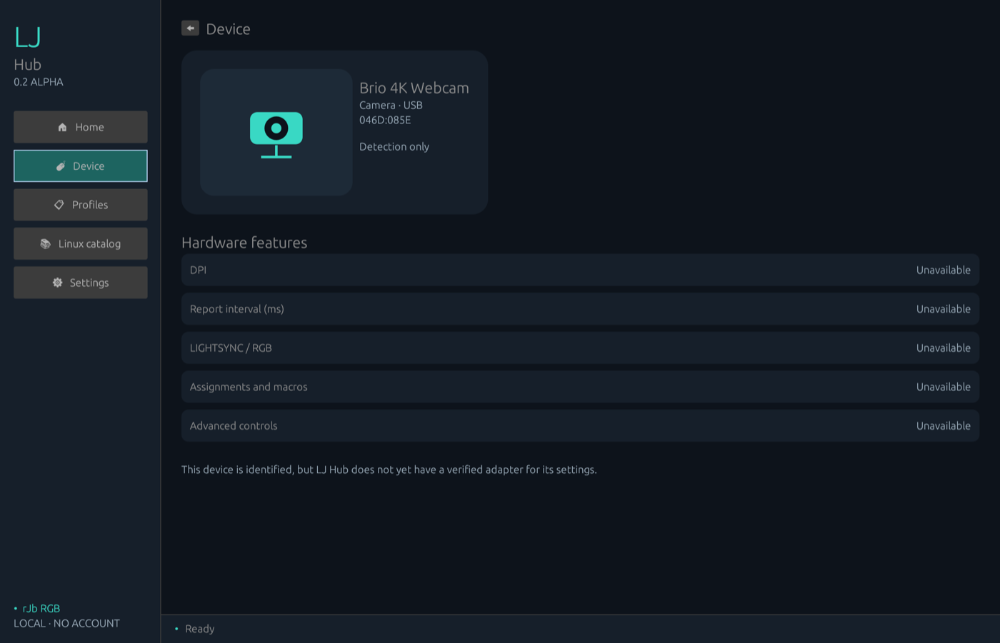

<p align="center"></p>

<h1 align="center">LJ Hub</h1>

<p align="center"><b>Local Logitech device profiles and inventory, with experimental DPI and report-rate controls.</b></p>

<p align="center"> <a href="https://github.com/jeremdevgit/lj-hub/releases"></a> <a href="LICENSE"></a> <a href="https://github.com/jeremdevgit/lj-hub/actions/workflows/ci.yml"></a></p>

<p align="center"><b>English</b> · <a href="README.fr.md">Français</a> · <a href="README.es.md">Español</a> · <a href="README.de.md">Deutsch</a> · <a href="README.it.md">Italiano</a> · <a href="README.pt.md">Português</a> · <a href="README.zh.md">简体中文</a> · <a href="README.ja.md">日本語</a></p>

<p align="center"><a href="https://github.com/jeremdevgit/lj-hub/releases"><b>⬇ Download</b></a></p>


LJ Hub is a lightweight, local-first manager for Logitech gaming devices. **It is an early alpha, not yet a G HUB replacement**, and an independent project not affiliated with Logitech.

<p> </p>

## At a glance

| | |
|---|---|
| **Category** | 🛠️ System & hardware |
| **Platforms** | Windows · macOS · Linux |
| **Interface** | 8 languages (EN, FR, ES, DE, IT, PT, ZH, JA) |
| **Price** | Free, open source, no ads, no telemetry |
| **Status** | Early alpha |
| **License** | [GPL-3.0-or-later](LICENSE) |

## What works today

| Feature | Windows | macOS | Linux |
|---|:-:|:-:|:-:|
| Discover Logitech USB HID devices | ✅ | ✅ | ✅ |
| Create, edit, duplicate and back up local profiles (JSON) | ✅ | ✅ | ✅ |
| Dashboard with category previews and capability status | ✅ | ✅ | ✅ |
| Search 116 Logitech IDs (pinned libratbag catalog) | ✅ | ✅ | ✅ |
| System USB/PnP inventory (cameras, wheels…) | ✅ | ✅ | ✅ |
| Set DPI and report rate | 🧪 HID++ 2.0 corded mice | — | 🧪 via `ratbagd` |
| Static color on LED 0 | — | — | 🧪 opt-in, via `ratbagd` |

🧪 = experimental, not yet verified on physical models.

RGB is **off by default** so [rJb](https://github.com/jeremdevgit/rjb) can own the lighting. Macros, key mapping, LIGHTSYNC effects, audio, webcams, wheels, firmware, game detection and automatic profile switching are not implemented. Seeing a device in the inventory does not mean it can be configured.

## Install

Download the latest pre-release from the [releases page](https://github.com/jeremdevgit/lj-hub/releases): a per-user `.exe` installer for Windows, an Apple Silicon `.dmg` for macOS and a `.deb` for Ubuntu/Debian x64. Windows and macOS packages are not signed with a trusted publisher certificate. Linux hardware controls need `ratbagd`, `ratbagctl` and a device supported by libratbag.

## Safety and privacy

- **No network requests, no account.** Profiles stay in your system's user configuration folder.
- Hardware writes are opt-in, checked against advertised values and read back afterwards; they will be enabled per device only after testing.

## Roadmap

1. Verify HID++ capabilities on physical devices for each system.
2. A tested capability table for DPI, polling rate, RGB and onboard profiles.
3. Button mapping and a bounded macro engine.
4. Headset, microphone, webcam and racing adapters where protocols are documented.
5. Per-game profile switching.

## Build from source

```sh
# Rust stable. On Linux also: libudev-dev libx11-dev libxi-dev libxcursor-dev
# libxrandr-dev libxkbcommon-dev libwayland-dev pkg-config
cargo run --locked --release
```

The device catalog comes from [libratbag's device files](https://github.com/libratbag/libratbag/tree/master/data/devices) at the commit pinned in `data/libratbag-logitech.json`; refresh it with `python3 tools/refresh_libratbag_catalog.py /path/to/libratbag`. Changes: [CHANGELOG.md](CHANGELOG.md).

## License

GPL-3.0-or-later — see [LICENSE](LICENSE). Logitech, G HUB and LIGHTSYNC are trademarks of their owner.

---

Found a vulnerability? Please report it privately (see [SECURITY.md](SECURITY.md)) rather than in a public issue.

## More free software by jeremdevgit

All free, open source and ad-free.

**🛠️ System & hardware** — [Boîte à outils](https://github.com/jeremdevgit/boite-a-outils) · [rJb](https://github.com/jeremdevgit/rjb) · [Decklight](https://github.com/jeremdevgit/decklight)

**📒 Productivity & data** — [Carnet de notes](https://github.com/jeremdevgit/carnet-rust) · [JMeca](https://github.com/jeremdevgit/jmeca) · [Suite Libre](https://jeremdevgit.github.io/suite-libre/)

**🎮 Music & games** — [Pomme](https://github.com/jeremdevgit/pomme) · [Ludothèque](https://github.com/jeremdevgit/ludotheque) · [AutoDex](https://github.com/jeremdevgit/autodex) · [Batailles de France](https://github.com/jeremdevgit/batailles-de-france)
