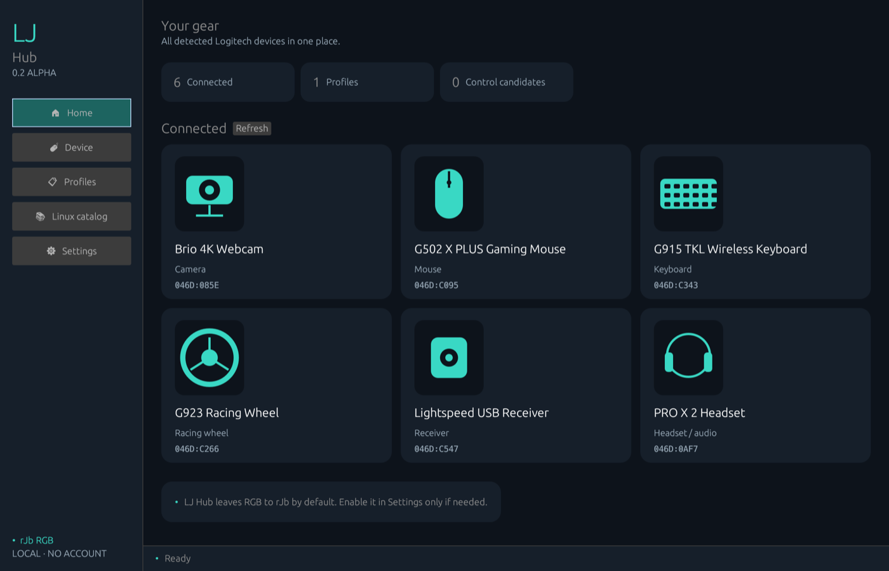
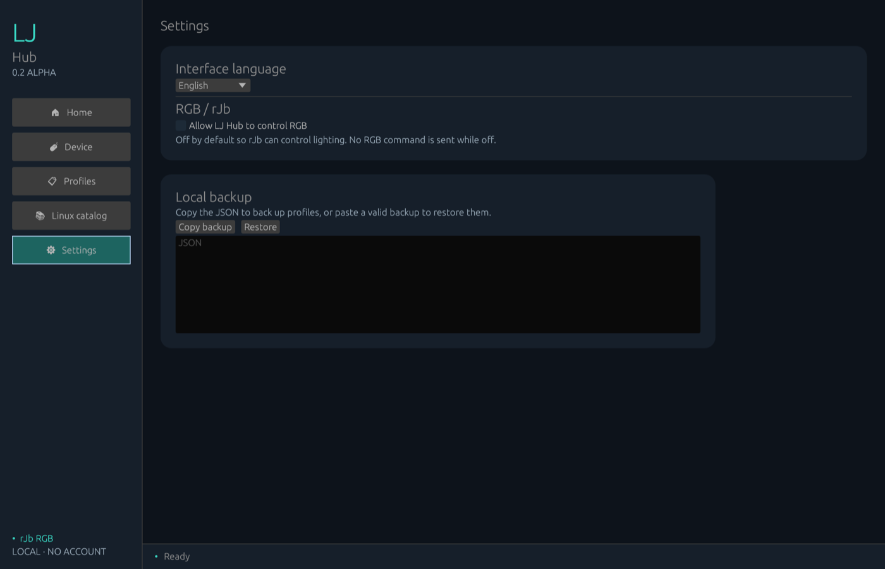

<p align="center"></p>

<h1 align="center">LJ Hub</h1>

<p align="center"><b>Perfis e inventário locais para dispositivos Logitech, com controlo experimental de DPI e frequência.</b></p>

<p align="center"> <a href="https://github.com/jeremdevgit/lj-hub/releases"></a> <a href="LICENSE"></a> <a href="https://github.com/jeremdevgit/lj-hub/actions/workflows/ci.yml"></a></p>

<p align="center"><a href="README.md">English</a> · <a href="README.fr.md">Français</a> · <a href="README.es.md">Español</a> · <a href="README.de.md">Deutsch</a> · <a href="README.it.md">Italiano</a> · <b>Português</b> · <a href="README.zh.md">简体中文</a> · <a href="README.ja.md">日本語</a></p>

<p align="center"><a href="https://github.com/jeremdevgit/lj-hub/releases"><b>⬇ Transferir</b></a></p>



O LJ Hub é um gestor leve e local para periféricos gaming da Logitech. **É uma alfa inicial, ainda não substitui o G HUB**, e é um projeto independente, sem afiliação à Logitech.

<p> </p>

## Em resumo

| | |
|---|---|
| **Categoria** | 🛠️ Sistema e hardware |
| **Plataformas** | Windows · macOS · Linux |
| **Interface** | 8 idiomas (EN, FR, ES, DE, IT, PT, ZH, JA) |
| **Preço** | Gratuito, de código aberto, sem anúncios nem telemetria |
| **Estado** | Alfa |
| **Licença** | [GPL-3.0-or-later](LICENSE) |

## O que funciona hoje

| Função | Windows | macOS | Linux |
|---|:-:|:-:|:-:|
| Detetar dispositivos USB HID da Logitech | ✅ | ✅ | ✅ |
| Criar, editar, duplicar e guardar perfis locais (JSON) | ✅ | ✅ | ✅ |
| Painel com pré-visualizações por categoria e estado das capacidades | ✅ | ✅ | ✅ |
| Pesquisar 116 IDs Logitech (catálogo libratbag fixado) | ✅ | ✅ | ✅ |
| Inventário USB/PnP do sistema (câmaras, volantes…) | ✅ | ✅ | ✅ |
| Ajustar DPI e taxa de relatório | 🧪 ratos com fio HID++ 2.0 | — | 🧪 via `ratbagd` |
| Cor fixa no LED 0 | — | — | 🧪 opcional, via `ratbagd` |

🧪 = experimental, ainda não verificado em modelos físicos.

O RGB vem **desativado por omissão** para deixar a iluminação ao [rJb](https://github.com/jeremdevgit/rjb). Macros, remapeamento de teclas, efeitos LIGHTSYNC, áudio, webcams, volantes, firmware, deteção de jogos e troca automática de perfil não estão implementados. Ver um dispositivo no inventário não significa que seja configurável.

## Instalar

Transfira a pré-versão mais recente na [página de versões](https://github.com/jeremdevgit/lj-hub/releases): instalador `.exe` por utilizador para Windows, `.dmg` Apple Silicon para macOS e `.deb` para Ubuntu/Debian x64. Os pacotes de Windows e macOS não estão assinados por um editor de confiança. No Linux, os controlos de hardware exigem `ratbagd`, `ratbagctl` e um dispositivo suportado pelo libratbag.

## Segurança e privacidade

- **Sem pedidos de rede, sem conta.** Os perfis ficam na pasta de configuração do utilizador do sistema.
- As escritas no hardware são opcionais, verificadas face aos valores anunciados e relidas a seguir; só serão ativadas dispositivo a dispositivo após testes.

## Roteiro

1. Verificar as capacidades HID++ em dispositivos reais em cada sistema.
2. Uma tabela de capacidades testada para DPI, taxa de relatório, RGB e perfis internos.
3. Remapeamento de botões e um motor de macros limitado.
4. Auscultadores, microfones, webcams e volantes onde os protocolos estejam documentados.
5. Troca de perfil por jogo.

## Compilar

```sh
# Rust estável. No Linux também: libudev-dev libx11-dev libxi-dev libxcursor-dev
# libxrandr-dev libxkbcommon-dev libwayland-dev pkg-config
cargo run --locked --release
```

O catálogo vem dos [ficheiros de dispositivos do libratbag](https://github.com/libratbag/libratbag/tree/master/data/devices) no commit fixado em `data/libratbag-logitech.json`; atualize com `python3 tools/refresh_libratbag_catalog.py /caminho/para/libratbag`. Alterações: [CHANGELOG.md](CHANGELOG.md).

## Licença

GPL-3.0-or-later — ver [LICENSE](LICENSE). Logitech, G HUB e LIGHTSYNC são marcas do respetivo proprietário.

---

Encontrou uma vulnerabilidade? Comunique-a em privado (consulte [SECURITY.md](SECURITY.md)) e não num issue público.

## Mais software livre de jeremdevgit

Todos gratuitos, de código aberto e sem anúncios.

**🛠️ Sistema e hardware** — [Boîte à outils](https://github.com/jeremdevgit/boite-a-outils) · [rJb](https://github.com/jeremdevgit/rjb) · [Decklight](https://github.com/jeremdevgit/decklight)

**📒 Produtividade e dados** — [Carnet de notes](https://github.com/jeremdevgit/carnet-rust) · [JMeca](https://github.com/jeremdevgit/jmeca) · [Suite Libre](https://jeremdevgit.github.io/suite-libre/)

**🎮 Música e jogos** — [Pomme](https://github.com/jeremdevgit/pomme) · [Ludothèque](https://github.com/jeremdevgit/ludotheque) · [AutoDex](https://github.com/jeremdevgit/autodex) · [Batailles de France](https://github.com/jeremdevgit/batailles-de-france)
